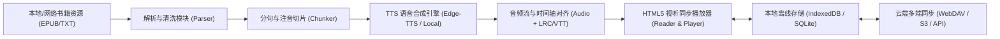

# Saga 架构设计与技术规范

本文档定义 `saga` 系统的核心数据流、模块接口与技术栈建议。

---

## 1. 整体数据流与流水线

---

## 2. 核心技术选型建议

| 模块 | 推荐技术 | 选型考量 |
| :--- | :--- | :--- |
| **容器底座** | **Tauri 2.0** / PWA | 支持跨全平台（Win/Mac/Linux/Android/iOS），体积仅数 MB，内存占用远低于 Electron；原生 Rust 处理多线程下载与音频转换性能卓越 |
| **前端交互** | **Vue 3 / React + TypeScript + TailwindCSS** | 高效的组件化渲染，极方便自定义深色模式、翻页物理仿真、字距行高设置 |
| **阅读解析** | `epub.js` / 自研 TXT 流式加载引擎 | 保证即使数百万字的网络小说或长篇巨著也能秒级打开、虚拟滚动不卡顿 |
| **语音合成 (TTS)** | 混合引擎：**Edge-TTS (在线高清)** + **Piper/ONNX (本地离线)** | 兼顾零门槛免费高质量声音，与断网时的本地离线自主可用性 |
| **数据与进度同步** | **WebDAV + CRDT / 状态增量对齐** | 开放、去中心化，用户可直接挂载自己的坚果云、NAS 或公共网盘，安全私密 |

---

## 3. 音画视听对齐机制 (Read-Along Synchronization)

为了实现“听书时屏幕文字实时跟着滚动与高亮”：
1. **切片**：正文按自然停顿（标点符号、段落）切分为 `SentenceChunk`，分配唯一 `chunk_id`。
2. **合成**：TTS 引擎在流式生成音频时，捕获每个 Chunk 对应的精确开始时间点 `start_ms` 与结束时间点 `end_ms`。
3. **元数据持久化**：生成配对的音频文件（如 `.m4a`）和时间对齐文件（如 `.vtt` / `.json`）。
4. **播放驱动**：HTML5 Audio 播放器的 `timeupdate` 事件驱动 DOM 节点的状态切换（激活 `.active-reading-sentence` 样式），并调用 `scrollIntoView({ behavior: 'smooth', block: 'center' })` 确保阅读视野始终对焦。
