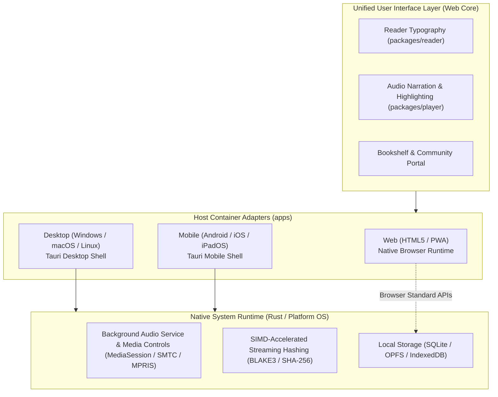

[English](architecture.md) | [简体中文](architecture_CN.md)

# Architecture

The current implementation is a Windows TXT reader prototype. Target platforms and services are described separately below.

## Current components

    apps/windows/
      src/                  Vue views, session library state, paragraph projection
      native/src/           Tauri commands, ingestion, paths, SQLite, review decisions
      tests/                Actual handlers/modules with mocked host boundaries
    packages/reader/        TXT decoding, heading selection, structural validation
    protocol/               Rust contracts, BLAKE3 identity, TypeScript bindings
    server/gateway/         Health and ping endpoints
    tools/                  Local checks and execution receipts

The native host depends on reader and protocol; reader depends on protocol. The frontend uses generated bindings and Tauri IPC, without direct SQLite access. The gateway depends on protocol and has no account, authentication, CAS, or sync implementation.

Vue views own interaction and lifecycle. The library store owns session selection and publishes persistent changes after native success. The text module provides one paragraph/sentence projection. Blocking workers perform native import and database work; the UI observes progress and completion separately.

## Reader and identity

The reader toolbar contains three icon buttons: return to the shelf, toggle the chapter directory, and open reading settings. Settings adjust the session font size from 16–32 px in steps of 2. Outside pointer input or Escape closes the popover; Escape restores trigger focus. Chapter navigation remains available through the directory and PageUp/PageDown.

The reader footer, global mini bar, and shelf read-along action require a nonempty audio Blob loaded for the selected book, with an audio MIME type. A filename or extension does not establish audio availability. Without audio, Space keeps normal scrolling; removing audio stops the demonstration timer. This check does not validate codec decodability or timeline alignment.

Current TXT imports provide no audio. The .saga parser and real playback remain unimplemented. [READ-01](evidence/2026-10-20-reader/result.json) records current control behavior and resource checks, not .saga support.

The sidebar centers the icon and Saga wordmark together, or the icon alone when collapsed. Windows taskbar/title-bar icons use the executable's ICO resource. Tauri configuration lists the assets, and the build script tracks ICO changes.

apps/windows/native/icons/source.png is the shared master for PNG/ICO/ICNS and browser assets. It is cropped to the visible rounded tile with transparent exterior pixels and no added padding. Sidebar rendering follows that silhouette with an alpha-aware shadow. Export normalization cleared residual opacity at the four extreme ICO corner pixels. ICON-03 records margins, corner alpha, and executable-frame comparisons.

## Data flow and limits

1. The native picker returns a TXT path. Import reads bytes, computes BLAKE3 identity, decodes text, and selects chapter boundaries.
2. SQLite stores book metadata, first chapter heading, and retained review fingerprints. All chapter indexing and TOC metadata are encoded directly in the $O(1)$ binary manifest (`manifest.bin`) alongside Deflate-compressed text slices (strictly <= 256 KB) inside a single, self-contained `.saga` archive container at `books/<book-id>.saga`. Redundant `sections` tables are eliminated from SQLite. Reimport replaces metadata and the `.saga` archive in one atomic transaction. Review saves commit decisions and replaces the `.saga` archive atomically.
3. The shelf loads lightweight summaries directly from the minimal SQLite `books` table without touching archive files. On startup, the most recently read book is pre-warmed in the background for instant 0ms reader opening. Selecting a book hydrates chapter sections on demand directly from `manifest.bin` and compressed chunk files. Repeated requests share a pending load. Catalog object identity prevents a late response from overwriting reimport or reviving a deleted book.
4. Reading derives sentence chunks when persisted chunks are absent. Browser preview keeps the entire TXT as one transient in-memory section without native parsing.

Debug data is under data/ in the compiled checkout. Packaged builds use the OS application-local data directory. The layout is `storage/saga.db` and single archive packages `books/<book-id>.saga`. Moving a checkout requires rebuilding the debug binary; an existing binary retains its compile-time source location.

SQLite and `.saga` archives are managed together. Import/delete transactions ensure metadata and archive consistency, and power-loss durability remains unqualified. [Maintenance](maintenance.md) defines failure guarantees and local-only evidence references. This cleanup did not move or reparse existing development data.

TTS, real audio playback, EPUB import, timeline alignment, synchronization, full CAS, other platforms, and release packaging remain open in [tasks.md](tasks.md).

## The .saga Asset Package Specification

The canonical `.saga` container is a standardized, deterministic ZIP archive (RFC 1951) functioning as an immutable, self-contained digital publication. It organizes content into five orthogonal architectural pillars:

```text
my_novel.saga (Standard Deterministic ZIP Container)
├── mimetype          # Identity: uncompressed (STORE) format signature
├── manifest.bin      # Dispatch: binary metadata + section TOC + audio routing
├── texts/            # Payload: multi-chapter Deflate slices strictly <= 256 KB
│   ├── 0.chunk
│   └── ...
├── timeline.bin      # Timeline: lazy-loaded sentence millisecond alignment spans
├── audio/            # Streams: uncompressed (STORE) AAC/Opus audio tracks
└── cover.jpg         # Media: isolated cover image for shelf hydration
```

### 1. Architectural Pillars and Loading Lifecycle

| Pillar | File Path | Compression | Lifecycle & Performance Contract |
| :--- | :--- | :--- | :--- |
| **Identity** | `mimetype` | STORE (0%) | Fixed 24 bytes (`application/x-saga-book`) at byte offset 30. Sniffed by external file managers without unzipping. The Saga reader runtime ignores it at startup (zero I/O). |
| **Dispatch** | `manifest.bin` | STORE (0%) | 20–30 KB fixed-size binary TOC and UTF-8 string pool. Loaded strictly once on book open (1 I/O). Provides instant metadata, catalog tree, chunk routing, and chapter audio availability. |
| **Payload** | `texts/*.chunk` | DEFLATE | Multi-chapter text blocks strictly bounded by 256 KB. Loaded on-demand: opening a book decompresses only the active reading chunk (1 I/O). Paragraphs are bounded by `\n\n`; sentences are deterministically split in memory on demand (zero index bloat). |
| **Timeline** | `timeline.bin` | DEFLATE | Sentence-level millisecond alignment spans. Never read during plain text reading. Loaded lazily per chapter (approx. 300 bytes per chapter) only when audio narration is active. |
| **Streams** | `audio/*.m4a` | STORE (0%) | Contiguous physical audio stream bytes. OS hardware decoders (MediaEngine, AVPlayer) stream directly via file descriptor offsets without intermediate extraction. |
| **Media** | `cover.jpg` | STORE / Native | Isolated cover graphic. Read independently by bookshelf views without parsing chapter indices, and omitted during text reading. |

### 2. Binary Manifest Layout (`manifest.bin`)

`manifest.bin` supersedes database-backed chapter tables for publication storage. It uses an arithmetic $O(1)$ addressable entry table:

1. **Header (64 bytes)**:
   - `magic`: 4 bytes (`SGMF`).
   - `version`: `u16` format revision.
   - `flags`: `u16` publication feature flags.
   - `sections_count`: `u32` total structural chapters.
   - `chunks_count`: `u32` total text slice files under `texts/`.
   - `total_chars`: `u32` total character count across the publication.
   - `volumes_offset`: `u32` byte offset to the volume offset table.
   - `title_ptr`: `[offset: u32, len: u16]` pointing into the string pool.
   - `author_ptr`: `[offset: u32, len: u16]` pointing into the string pool.
   - `desc_ptr`: `[offset: u32, len: u16]` pointing into the string pool.
   - `toc_offset`: `u32` byte offset where the fixed-size TOC array begins.
   - `volume_count`: `u16` total volumes.
   - `string_pool_offset`: `u32` byte offset where UTF-8 text attributes begin.
   - `reserved`: 12 bytes reserved for schema evolution.
2. **Volume Table (6 bytes per volume, $O(1)$ lookup)**:
   - `offset`: `u32` byte offset into string pool.
   - `length`: `u16` UTF-8 byte length of volume title.
3. **Section TOC Entries (32 bytes per section, 8-byte aligned)**:
   - `chunk_index`: `u16` referencing `texts/{chunk_index}.chunk`.
   - `flags`: `u16` flags (bit 0 indicates audio availability).
   - `chunk_offset`: `u32` uncompressed byte start within the decompressed chunk.
   - `byte_length`: `u32` uncompressed chapter text byte length.
   - `char_count`: `u32` character count for progress computation.
   - `volume_id`: `u16` volume ordinal index into Volume Table.
   - `title_offset`: `u32` relative title offset in the string pool.
   - `title_length`: `u16` title UTF-8 byte length.
   - `audio_duration_ms`: `u32` total chapter audio length in milliseconds.
   - `timeline_offset`: `u32` byte offset in `timeline.bin` for sentence spans.
4. **String Pool**:
   - Contiguous packed UTF-8 byte sequence holding book title, author, description, volume titles, and chapter titles.

### 3. Separation of Publication Asset and User State

- **Publication Asset (`.saga`)**: Immutable, content-addressed (BLAKE3), and crash-resilient. Shareable across devices with zero side effects.
- **User State (`saga.db`)**: Local client SQLite database storing mutable user data:
  - Reading progress anchor: `{ chapter_index: u32, paragraph_index: u16, sentence_index: u16, char_offset: u16, scroll_ratio: f16 }` (12 bytes).
  - User highlights, bookmarks, notes, and local shelf metadata.

## Target design — not implemented as a complete system

The following design remains the intended direction. Planned directory names describe future responsibilities and are not reasons to create empty components. Performance figures are targets or historical assumptions, not current measurements.

### 1. System Positioning and Design Principles

- **System Definition**: A unified, cross-platform digital book reader and immersive audiobook playback suite.
- **Target Platforms (7 Targets)**: Android, iOS, iPadOS, macOS, Windows, Linux, and HTML (Standard Web / PWA).
- **Local-First**: Full offline operational capability for bookshelves, cached book files, and audio chapters; transparent delta synchronization when connected.
- **Read-Along Synchronization**: Sentence-level temporal alignment between parsed text segments and generated audio streams, supporting real-time text highlighting and smooth auto-scrolling during narration.
- **Content-Addressed Storage (CAS)**: Book and audio physical assets are addressed and deduplicated via cryptographic content hashes, enabling instant global uploads and zero-copy cross-user sharing.

---

### 2. Repository and Module Layout

Governed by the baseline rules in [docs/coding.md](coding.md) (single-word identifiers, contextual scope elimination of redundant prefixes, and clean ownership boundaries):

```text
saga/
├── apps/                        # Application delivery hosts
│   ├── web/                     # Unified HTML5 application (Web SPA / PWA)
│   ├── desktop/                 # Desktop host (Tauri: Windows / macOS / Linux)
│   └── mobile/                  # Mobile host (Tauri Mobile: Android / iOS / iPadOS)
│
├── packages/                    # Client-side domain packages
│   ├── reader/                  # Book parsing, flow layout, and rendering (EPUB / TXT)
│   ├── player/                  # Audio playback, background persistence, and highlight timeline
│   ├── speech/                  # Sentence chunking and TTS synthesis interfaces
│   ├── storage/                 # Local persistence layer (IndexedDB / SQLite adapters)
│   └── sync/                    # Client-side delta sync state machine and offline mutation queue
│
├── server/                      # Server components
│   ├── gateway/                 # API gateway, authentication (JWT/Passkey), and rate limiting
│   ├── cas/                     # Content-Addressed Storage, hash deduplication, and blob management
│   ├── sync/                    # Account metadata, reading progress, and bookmark merge services
│   └── share/                   # Resource sharing tokens and community catalog aggregation
│
├── protocol/                    # Single source of truth for cross-tier schemas and contracts
├── tools/                       # Build scripts, code generators, and maintenance tooling
├── tests/                       # Cross-component end-to-end integration and protocol verification
└── docs/                        # Architectural documentation and engineering guidelines
```

---

### 3. All-Platform Client Architecture



- **Unified Web Core**: Built using modern Web standards (TypeScript + reactive component framework + Tailwind CSS). All reading typography, pagination, virtual scrolling, and read-along highlighting logic are 100% shared across all 7 platforms.
- **iPadOS Tailoring**: Responsive dual-page spreads, Split View multitasking, Slide Over floating panels, and touch/pencil gesture handling.
- **Native Host Substrate**: Desktop and mobile variants run inside Tauri 2.0 shells, delegating background audio lifecycles, lock-screen controls, and compute-heavy hashing tasks to native Rust.

---

### 4. Content-Addressed Storage (CAS) and Deduplication

#### 4.1 Hash Algorithm and Object Addressing
- Physical assets (original book files and audio segment streams) are identified by cryptographic content hashes (**BLAKE3** or **SHA-256**).
- Storage layout follows standard two-tier prefix sharding:
  `/cas/{hash[0:2]}/{hash[2:4]}/{hash}`

#### 4.2 Audio Synthesis Idempotency Fingerprint
To prevent redundant TTS generation across users reading identical chapters with identical voice settings:
$$\text{AudioGenHash} = \text{Hash}(\text{CleanedText} + \text{Model} + \text{Voice} + \text{Speed} + \text{Pitch})$$
When a synthesis request matches an existing fingerprint in the catalog, the server returns the existing audio blob reference immediately without invoking TTS synthesis pipelines.

#### 4.3 Instant Uploads and Reference Counting
1. **Pre-flight Check**: The client hashes the target file locally and submits `POST /api/cas/check` with `{ hash, size, mime_type }`.
2. **Cache Hit**: If the physical blob exists in the CAS pool, the server creates a logical reference linking the file to the user's personal shelf, increments the blob's reference count, and returns success immediately (sub-second instant upload).
3. **Cache Miss**: The client streams the file via chunked upload. The server verifies integrity against the expected hash before committing to the CAS pool.
4. **Garbage Collection (GC)**: When references are removed, reference counts decrement. When a count reaches zero, the object enters a grace period (e.g., 30 days) before automated reclamation.

---

### 5. Account Data and Local-First Synchronization

- **Synchronized State Scope**: Reading positions (chapter, character index, scroll percentage), audio positions (seconds elapsed), bookmarks, text highlights, notes, and user preferences.
- **Mutation Log Protocol**: Offline mutations are buffered locally in an append-only `mutation_log` stamped with Hybrid Logical Clocks (HLC). Upon network availability, the client submits delta mutations, keeping network payloads compact (typically under 10 KB).
- **Conflict Resolution**: Last-Write-Wins (LWW) parameterized by monotonic logical timestamps resolves divergent cross-device reading positions.

---

### 6. Community Extensions and Resource Sharing

- **Zero-Copy Resource Sharing**:
  - Users can generate cryptographic `Share Tokens` for books, audiobook packages (book + timeline manifest + audio blobs), or curated collections.
  - Recipients claiming a shared token obtain direct metadata pointers to existing CAS blobs in their own library, consuming zero additional physical storage on the server.
- **Extension Plugin Sandboxing**:
  - Sandboxed execution interfaces for third-party book source scrapers and catalog metadata fetchers.
  - Pluggable `TTSProvider` contracts accommodating cloud providers (Edge-TTS, OpenAI, Azure) alongside local inference engines (Piper, Sherpa-ONNX, CosyVoice).
