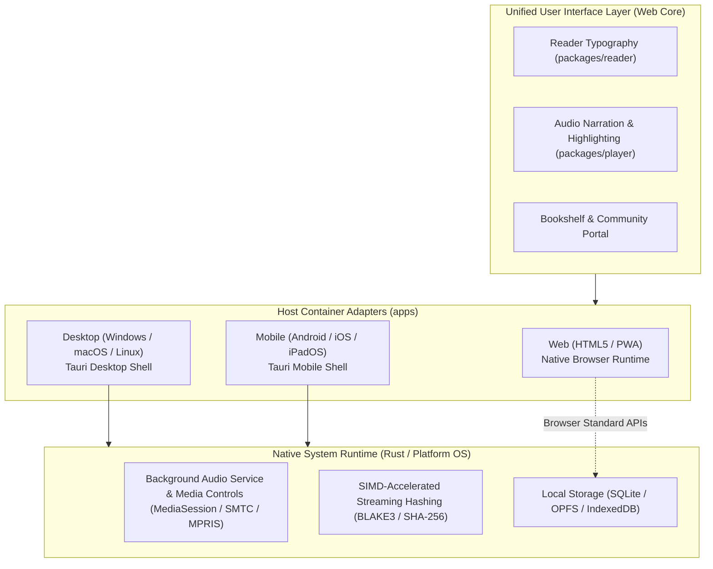

[English](architecture.md) | [简体中文](architecture_CN.md)

# Architecture

The current implementation is a Windows TXT reader prototype. Target platforms and services are described separately below.

## Current components

    apps/windows/
      src/                  Vue views, session library state, paragraph projection
      native/src/           Tauri commands, ingestion, paths, SQLite, review decisions
      tests/                Actual handlers/modules with mocked host boundaries
    packages/reader/        TXT decoding, heading selection, structural validation
    protocol/               Rust contracts, BLAKE3 identity, TypeScript bindings
    server/gateway/         Health and ping endpoints
    tools/                  Local checks and execution receipts

The native host depends on reader and protocol; reader depends on protocol. The frontend uses generated bindings and Tauri IPC, without direct SQLite access. The gateway depends on protocol and has no account, authentication, CAS, or sync implementation.

Vue views own interaction and lifecycle. The library store owns session selection and publishes persistent changes after native success. The text module provides one paragraph/sentence projection. Blocking workers perform native import and database work; the UI observes progress and completion separately.

## Reader and identity

The reader toolbar contains three icon buttons: return to the shelf, toggle the chapter directory, and open reading settings. Settings adjust the session font size from 16–32 px in steps of 2. Outside pointer input or Escape closes the popover; Escape restores trigger focus. Chapter navigation remains available through the directory and PageUp/PageDown.

The reader footer, global mini bar, and shelf read-along action require a nonempty audio Blob loaded for the selected book, with an audio MIME type. A filename or extension does not establish audio availability. Without audio, Space keeps normal scrolling; removing audio stops the demonstration timer. This check does not validate codec decodability or timeline alignment.

Current TXT imports provide no audio. Native `.saga` import/export and text decoding are implemented; archive audio resources are preserved but are not loaded into a player. Real playback remains unimplemented. [READ-01](evidence/2026-10-20-reader/result.json) describes the earlier control milestone; it predates package support.

The sidebar centers the icon and Saga wordmark together, or the icon alone when collapsed. Windows taskbar/title-bar icons use the executable's ICO resource. Tauri configuration lists the assets, and the build script tracks ICO changes.

apps/windows/native/icons/source.png is the shared master for PNG/ICO/ICNS and browser assets. It is cropped to the visible rounded tile with transparent exterior pixels and no added padding. Sidebar rendering follows that silhouette with an alpha-aware shadow. Export normalization cleared residual opacity at the four extreme ICO corner pixels. ICON-03 records margins, corner alpha, and executable-frame comparisons.

## Data flow and limits

1. The native picker and file import accept TXT and `.saga`. TXT ingestion reads bytes, computes BLAKE3 identity, decodes text, and selects chapter boundaries. Package import validates metadata, ZIP resources, complete Deflate streams, and referenced UTF-8 text before publishing a shelf record.
2. SQLite stores book metadata, first heading, reading anchors, and retained review fingerprints. Chapter metadata lives in `manifest.bin`; chapter bodies live in raw Deflate payloads inside ZIP STORE entries. The writer targets **less than 256 KiB (262,144 bytes) of compressed data per multi-chapter chunk**. A single chapter at or above that size remains accepted in its own chunk; uncompressed size is not this limit. Empty-body chapters retain TOC entries.
3. Imports and text edits prepare a sibling staging archive, update SQLite inside a transaction, retain the old archive as a backup, publish the replacement, and commit the catalog. Ordinary replacement/commit failures attempt to restore the old archive and roll back the catalog. An in-process lock prevents readers from observing the replacement interval. This is not cross-process or crash atomicity. Review-only saves keep the archive bytes unchanged; text edits preserve additional resources and retain audio routing only for uniquely matched, unchanged chapter bodies.
4. Shelf summaries read SQLite without opening archives. Startup schedules background hydration of the most recent book; no fixed opening latency is established. Opening a book currently decodes all chapter bodies, with eager sentence projection limited to the first five chapters, matching TXT ingestion. Repeated loads share a pending request. Catalog generations and object identity reject obsolete hydration and summary responses after edits, reimport, or deletion.
5. Reading derives missing sentence chunks using the same terminal/quote rules as the native reader. Audit drafts discard derived chunks before edits. Continuous reading removes distant offscreen chapters while preserving a scroll anchor, retaining at least five chapters plus any needed viewport buffer. The book bodies and a large individual chapter remain resident; total memory and long-session performance remain unqualified. Browser preview accepts only TXT and keeps the entire file as one transient section.
6. Reading anchors are coalesced per book and sent through one ordered writer. Explicit flush waits for issued writes; errors retain the latest queued anchor for retry and remain visible. Reimport preserves a valid anchor and clamps one invalidated by the replacement structure. Successful deletion cancels pending positions for that book.

Debug data is under data/ in the compiled checkout. Packaged builds use the OS application-local data directory. The layout is `storage/saga.db` and single archive packages `books/<book-id>.saga`. Moving a checkout requires rebuilding the debug binary; an existing binary retains its compile-time source location.

SQLite and `.saga` archives are managed together under the ordinary-failure contract above. Recovery failures report the retained backup path; a process crash, external writer, or power loss can still leave catalog/archive disagreement. [Maintenance](maintenance.md) defines validation and remaining limits. Repair verification uses isolated fixtures and does not migrate existing development data.

TTS, real audio playback, EPUB import, timeline alignment, synchronization, full CAS, other platforms, and release packaging remain open in [tasks.md](tasks.md).

## The .saga Asset Package Specification

The current `.saga` container is a ZIP archive carrying a version-1 SGMF manifest and raw Deflate text streams. `protocol/src/package.rs` owns the binary layout. ZIP entry encoding and raw Deflate (RFC 1951) are separate layers. The following names include resources reserved for future audio/media integration; their presence alone does not establish playback support or deterministic archive bytes across toolchains.

```text
my_novel.saga (ZIP container)
├── mimetype          # Identity: uncompressed (STORE) format signature
├── manifest.bin      # Dispatch: binary metadata + section TOC + audio routing
├── texts/            # Raw Deflate payloads, stored as ZIP STORE entries
│   ├── 0.chunk
│   └── ...
├── timeline.bin      # Timeline: lazy-loaded sentence millisecond alignment spans
├── audio/            # Streams: uncompressed (STORE) AAC/Opus audio tracks
└── cover.jpg         # Media: isolated cover image for shelf hydration
```

### 1. Architectural Pillars and Loading Lifecycle

| Pillar | File Path | Compression | Lifecycle & Performance Contract |
| :--- | :--- | :--- | :--- |
| **Identity** | `mimetype` | ZIP STORE on write | Writer emits the 22-byte `application/x-saga-book` signature first. Import/load validates it by entry name; no universal byte offset or zero-I/O claim applies. |
| **Dispatch** | `manifest.bin` | ZIP STORE on write | 64-byte header, 32-byte section entries, volume pointers, and variable UTF-8 string pool. A view can seek a section in O(1); current full-book loading decodes all entries. |
| **Payload** | `texts/*.chunk` | Raw Deflate inside ZIP STORE | Writer's multi-chapter target is compressed size <256 KiB; a larger single chapter is accepted unchanged as one chunk. Each declared stream is decoded once per book load, checked for completion and declared byte extent, then split into UTF-8 chapter bodies. Nonempty lines define paragraphs. |
| **Timeline** | `timeline.bin` | Preserved from input | Reserved sentence/audio alignment resource. Import validates ZIP integrity and edits retain bytes; timeline semantics and playback are not implemented. |
| **Streams** | `audio/*` | Preserved from input | Audio bytes survive review and text edits. Unchanged unique body matches retain routing; changed or ambiguous bodies clear the active route. No codec or timeline qualification is asserted. |
| **Media** | `cover.jpg` and additional resources | Preserved from input | ZIP integrity is checked and resource bytes are retained during edits. Shelf media hydration remains unimplemented. |

### 2. Binary Manifest Layout (`manifest.bin`)

`manifest.bin` supersedes database-backed chapter tables for publication storage. It uses an arithmetic $O(1)$ addressable entry table:

1. **Header (64 bytes, little-endian)**, in byte order:
   - `0..4`: `magic` (`SGMF`); `4..6`: `version` (`u16`); `6..8`: `flags` (`u16`, zero in version 1).
   - `8..12`: `sections_count` (`u32`); `12..16`: `chunks_count` (`u32`); `16..20`: `total_chars` (`u32`).
   - `20..24`: `volumes_offset` (`u32`); `24..32`: `toc_offset` (`u64`); `32..40`: `string_pool_offset` (`u64`).
   - `40..44`: title pool offset (`u32`); `44..46`: title byte length (`u16`); `46..48`: `volume_count` (`u16`).
   - `48..52`: author pool offset (`u32`); `52..54`: author byte length (`u16`); `54..56`: reserved (`u16`, zero).
   - `56..60`: description pool offset (`u32`); `60..62`: description byte length (`u16`); `62..64`: reserved (`u16`, zero).
2. **Volume Table (6 bytes per volume, $O(1)$ lookup)**:
   - `offset`: `u32` byte offset into string pool.
   - `length`: `u16` UTF-8 byte length of volume title.
3. **Section TOC Entries (32 bytes per section)**:
   - `chunk_index`: `u16` referencing `texts/{chunk_index}.chunk`.
   - `flags`: `u16` flags (bit 0 indicates audio availability).
   - `chunk_offset`: `u32` uncompressed byte start within the decompressed chunk.
   - `byte_length`: `u32` uncompressed chapter text byte length.
   - `char_count`: `u32` character count for progress computation.
   - `volume_id`: `u16` volume ordinal index into Volume Table.
   - `title_length`: `u16` title UTF-8 byte length.
   - `title_offset`: `u32` relative title offset in the string pool.
   - `audio_duration_ms`: `u32` total chapter audio length in milliseconds.
   - `timeline_offset`: `u32` byte offset in `timeline.bin` for sentence spans.
4. **String Pool**:
   - Contiguous packed UTF-8 byte sequence holding book title, author, description, volume titles, and chapter titles.
   - Each string is limited to 65,535 UTF-8 bytes. Encoding rejects oversized values instead of truncating them. Table counts, offsets, references, unknown flags, and UTF-8 are checked before use.
   - The `u16` chunk reference permits at most 65,536 chunks. `u16` volume count permits at most 65,535 volumes. Writer character totals count Unicode scalar values, not UTF-8 bytes or grapheme clusters.

### 3. Separation of Publication Asset and User State

- **Publication Asset (`.saga`)**: Self-contained export/import unit. Initial identity is BLAKE3 of original TXT bytes or imported archive bytes. Audit edits retain that book identity while changing archive content, so the current library is not an immutable content-addressed store.
- **User State (`saga.db`)**: Local client SQLite database storing mutable user data:
  - Reading progress anchor: `{ last_chapter_index: u32, last_paragraph_index: u32, last_scroll_ratio: f64, last_read_time: i64 }` stored in the `books` catalog table, synchronizing exact chapter, paragraph, and scroll ratio.
  - Retained review fingerprints and local shelf metadata are implemented. Highlights, bookmarks, and notes remain target features.

## Target design — not implemented as a complete system

The following design remains the intended direction. Planned directory names describe future responsibilities and are not reasons to create empty components. Performance figures are targets or historical assumptions, not current measurements.

### 1. System Positioning and Design Principles

- **System Definition**: A unified, cross-platform digital book reader and immersive audiobook playback suite.
- **Target Platforms (7 Targets)**: Android, iOS, iPadOS, macOS, Windows, Linux, and HTML (Standard Web / PWA).
- **Local-First**: Full offline operational capability for bookshelves, cached book files, and audio chapters; transparent delta synchronization when connected.
- **Read-Along Synchronization**: Sentence-level temporal alignment between parsed text segments and generated audio streams, supporting real-time text highlighting and smooth auto-scrolling during narration.
- **Content-Addressed Storage (CAS)**: Book and audio physical assets are addressed and deduplicated via cryptographic content hashes, enabling instant global uploads and zero-copy cross-user sharing.

---

### 2. Repository and Module Layout

Governed by the baseline rules in [docs/coding.md](coding.md) (single-word identifiers, contextual scope elimination of redundant prefixes, and clean ownership boundaries):

```text
saga/
├── apps/                        # Application delivery hosts
│   ├── web/                     # Unified HTML5 application (Web SPA / PWA)
│   ├── desktop/                 # Desktop host (Tauri: Windows / macOS / Linux)
│   └── mobile/                  # Mobile host (Tauri Mobile: Android / iOS / iPadOS)
│
├── packages/                    # Client-side domain packages
│   ├── reader/                  # Book parsing, flow layout, and rendering (EPUB / TXT)
│   ├── player/                  # Audio playback, background persistence, and highlight timeline
│   ├── speech/                  # Sentence chunking and TTS synthesis interfaces
│   ├── storage/                 # Local persistence layer (IndexedDB / SQLite adapters)
│   └── sync/                    # Client-side delta sync state machine and offline mutation queue
│
├── server/                      # Server components
│   ├── gateway/                 # API gateway, authentication (JWT/Passkey), and rate limiting
│   ├── cas/                     # Content-Addressed Storage, hash deduplication, and blob management
│   ├── sync/                    # Account metadata, reading progress, and bookmark merge services
│   └── share/                   # Resource sharing tokens and community catalog aggregation
│
├── protocol/                    # Single source of truth for cross-tier schemas and contracts
├── tools/                       # Build scripts, code generators, and maintenance tooling
├── tests/                       # Cross-component end-to-end integration and protocol verification
└── docs/                        # Architectural documentation and engineering guidelines
```

---

### 3. All-Platform Client Architecture



- **Unified Web Core**: Built using modern Web standards (TypeScript + reactive component framework + Tailwind CSS). All reading typography, pagination, virtual scrolling, and read-along highlighting logic are 100% shared across all 7 platforms.
- **iPadOS Tailoring**: Responsive dual-page spreads, Split View multitasking, Slide Over floating panels, and touch/pencil gesture handling.
- **Native Host Substrate**: Desktop and mobile variants run inside Tauri 2.0 shells, delegating background audio lifecycles, lock-screen controls, and compute-heavy hashing tasks to native Rust.

---

### 4. Content-Addressed Storage (CAS) and Deduplication

#### 4.1 Hash Algorithm and Object Addressing
- Physical assets (original book files and audio segment streams) are identified by cryptographic content hashes (**BLAKE3** or **SHA-256**).
- Storage layout follows standard two-tier prefix sharding:
  `/cas/{hash[0:2]}/{hash[2:4]}/{hash}`

#### 4.2 Audio Synthesis Idempotency Fingerprint
To prevent redundant TTS generation across users reading identical chapters with identical voice settings:
$$\text{AudioGenHash} = \text{Hash}(\text{CleanedText} + \text{Model} + \text{Voice} + \text{Speed} + \text{Pitch})$$
When a synthesis request matches an existing fingerprint in the catalog, the server returns the existing audio blob reference immediately without invoking TTS synthesis pipelines.

#### 4.3 Instant Uploads and Reference Counting
1. **Pre-flight Check**: The client hashes the target file locally and submits `POST /api/cas/check` with `{ hash, size, mime_type }`.
2. **Cache Hit**: If the physical blob exists in the CAS pool, the server creates a logical reference linking the file to the user's personal shelf, increments the blob's reference count, and returns success immediately (sub-second instant upload).
3. **Cache Miss**: The client streams the file via chunked upload. The server verifies integrity against the expected hash before committing to the CAS pool.
4. **Garbage Collection (GC)**: When references are removed, reference counts decrement. When a count reaches zero, the object enters a grace period (e.g., 30 days) before automated reclamation.

---

### 5. Account Data and Local-First Synchronization

- **Synchronized State Scope**: Reading positions (chapter, character index, scroll percentage), audio positions (seconds elapsed), bookmarks, text highlights, notes, and user preferences.
- **Mutation Log Protocol**: Offline mutations are buffered locally in an append-only `mutation_log` stamped with Hybrid Logical Clocks (HLC). Upon network availability, the client submits delta mutations, keeping network payloads compact (typically under 10 KB).
- **Conflict Resolution**: Last-Write-Wins (LWW) parameterized by monotonic logical timestamps resolves divergent cross-device reading positions.

---

### 6. Community Extensions and Resource Sharing

- **Zero-Copy Resource Sharing**:
  - Users can generate cryptographic `Share Tokens` for books, audiobook packages (book + timeline manifest + audio blobs), or curated collections.
  - Recipients claiming a shared token obtain direct metadata pointers to existing CAS blobs in their own library, consuming zero additional physical storage on the server.
- **Extension Plugin Sandboxing**:
  - Sandboxed execution interfaces for third-party book source scrapers and catalog metadata fetchers.
  - Pluggable `TTSProvider` contracts accommodating cloud providers (Edge-TTS, OpenAI, Azure) alongside local inference engines (Piper, Sherpa-ONNX, CosyVoice).
