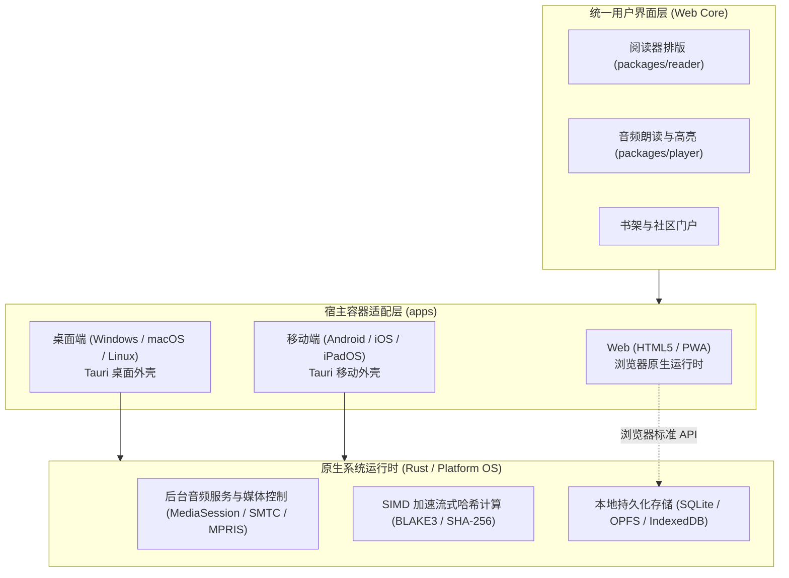

[English](architecture.md) | [简体中文](architecture_CN.md)

# 架构

当前实现为 Windows TXT 阅读器原型。目标平台及服务在下文单独说明。

## 当前组件

    apps/windows/
      src/                  Vue 视图、会话书架状态、段落映射
      native/src/           Tauri 命令、导入、路径、SQLite、核验决策
      tests/                使用模拟宿主边界的真实处理函数/模块测试
    packages/reader/        TXT 解码、标题选择、结构校验
    protocol/               Rust 契约、BLAKE3 标识、TypeScript 绑定
    server/gateway/         健康检查和 ping 端点
    tools/                  本地检查与执行回执

原生宿主依赖 reader、protocol；reader 依赖 protocol。前端使用生成的绑定及 Tauri IPC，不直接访问 SQLite。网关依赖 protocol，尚未实现账号、认证、CAS 或同步。

Vue 视图负责交互和生命周期。书架状态库负责会话选择，在原生操作成功后发布持久化变更。text 模块统一提供段落/句子映射。阻塞工作线程执行原生导入及数据库操作，界面分别观察进度和完成状态。

## 阅读界面与视觉标识

阅读工具栏包含三个图标按钮：返回书架、切换章节目录、打开阅读设置。设置以 2 px 为步长调整当前会话字号，范围为 16–32 px。外部指针操作或 Escape 关闭浮层；Escape 将焦点移回触发按钮。目录和 PageUp/PageDown 仍可切换章节。

阅读底栏、全局迷你条及书架伴读操作，要求当前书籍已加载非空音频 Blob，且 MIME 类型为音频。文件名或扩展名不代表存在音频。无音频时，Space 保持正常滚动；移除音频时停止演示定时器。该检查不校验编解码器可解码性或时间轴对齐。

当前 TXT 导入不提供音频。原生 `.saga` 导入、导出及文本解码已实现；归档中的音频资源会保留，但不会加载到播放器。真实播放尚未实现。[READ-01](evidence/2026-10-20-reader/result.json)描述的是较早的控件里程碑，早于资产包支持。

侧边栏将图标与 Saga 字标整体居中，折叠时图标单独居中。Windows 任务栏/标题栏使用可执行文件中的 ICO 资源。Tauri 配置列出资产，构建脚本跟踪 ICO 变更。

apps/windows/native/icons/source.png 是 PNG/ICO/ICNS 及浏览器资产的共享母版。母版紧贴可见圆角底板裁切，外部像素透明，不增加留白。侧边栏按该轮廓绘制支持 Alpha 通道的投影。导出规范化处理清除了 ICO 四个顶角像素的残余不透明度。ICON-03 记录边距、角点 Alpha 及可执行文件图像帧比对结果。

## 数据流与限制

1. 原生选择框和文件导入接受 TXT 及 `.saga`。TXT 导入读取字节、计算 BLAKE3 标识、解码文本并选定章节边界。资产包导入先校验元数据、ZIP 资源、完整 Deflate 流及所引用的 UTF-8 文本，再发布书架记录。
2. SQLite 存储书籍元数据、首章标题、阅读锚点及已保留的核验指纹。章节元数据位于 `manifest.bin`；章节正文以原始 Deflate 载荷存放在 ZIP STORE 条目中。写入器以**每个多章切片的压缩数据小于 256 KiB（262,144 字节）**为目标。单章达到或超过该大小时仍接受，并独占一个切片；该限制不针对未压缩大小。正文为空的章节保留目录项。
3. 导入和正文编辑先准备同目录的暂存归档，在事务中更新 SQLite，将旧归档保留为备份，发布替换归档，再提交书架数据。普通替换或提交失败时，会尝试恢复旧归档并回滚书架数据。进程内锁防止读取方观察到替换过程中的中间状态。这不提供跨进程或崩溃原子性。仅保存核验决策时保持归档字节不变；正文编辑保留附加资源，仅对正文未变且唯一匹配的章节保留音频路由。
4. 书架摘要读取 SQLite，不打开归档。启动时调度最近阅读书籍的后台加载；尚未确定固定的打开耗时。打开书籍目前会解码全部章节正文，仅对前五章预先分句，与 TXT 导入保持一致。重复加载共享进行中的请求。书架变更代次与对象标识共同拒绝编辑、重导入或删除后的过期正文和摘要响应。
5. 阅读器按需补充分句，使用与原生阅读模块相同的句末标点及引号规则。核验草稿在编辑前丢弃派生分句。连续阅读在保留滚动锚点的同时移除远离视口的章节，至少保留五章及视口所需的缓冲内容。全书正文和大型单章仍驻留内存；总内存及长时间阅读性能尚未完成合格性认定。浏览器预览仅接受 TXT，并将完整文件保留为单个临时章节。
6. 阅读锚点按书籍合并，由单个有序写入器发送。设置中可选择 5、10、15、30 或 60 秒的自动保存最长等待时间，默认 30 秒；该界面偏好保存在 webview 本地存储中。首个未保存锚点启动定时器，持续滚动不重置定时器，修改间隔时计入已等待时间。已确认且未变化的锚点不重复写入。返回书架、桌面窗口失焦、变为隐藏及正常关闭窗口时，会请求提前保存。正常关闭会等待保存成功，失败时保留窗口。显式刷新等待已发出及排队中的写入；错误发生时保留最新锚点供重试。重导入保留有效锚点，将因替换结构而失效的锚点限制到有效范围。成功删除书籍后，取消该书待写入的位置。

原生应用拥有一个 SQLite 连接，在启动时初始化并保留于托管状态中。现有阻塞工作线程通过该连接的互斥锁串行执行完整的书架目录操作；进度更新复用缓存的预编译语句。这消除了每次命令执行时的连接建立与模式初始化，不新增存储格式，也不迁移现有书籍。耗时归档操作仍可能延迟排队中的进度写入。设置页可在刷新进度后，显式将已持久化的书架元数据、阅读锚点和核验指纹导出为可读 JSON；这是诊断快照，不是实时镜像或恢复接口。[RESIDENT-01](maintenance_CN.md#常驻书架目录与有界进度保存resident-01)记录契约、时间限制和验证情况。

调试数据位于编译时检出目录的 data/ 下。打包构建使用操作系统的应用本地数据目录。布局为 `storage/saga.db` 和单归档包 `books/<book-id>.saga`。移动检出目录后须重建调试程序；已有程序保留编译时的源码位置。

SQLite 与 `.saga` 归档按上述普通故障契约协同管理。恢复失败时报告保留的备份路径；进程崩溃、外部写入方或断电仍可能导致书架与归档不一致。[维护文档](maintenance_CN.md)说明校验及剩余限制。修复验证使用隔离测试数据，不迁移现有开发数据。

TTS、真实音频播放、EPUB 导入、时间轴对齐、同步、完整 CAS、其他平台及发布打包仍列于[任务台账](tasks_CN.md)。

[本地朗读与便携部署审核](speech_CN.md)记录 Windows 宿主约束、固定音色的朗读方向、候选引擎及待完成的本机验证。它不代表已实现语音子系统。

## .saga 资产包规范

当前 `.saga` 容器是承载版本 1 SGMF 清单和原始 Deflate 文本流的 ZIP 归档。二进制布局由 `protocol/src/package.rs` 定义。ZIP 条目编码与原始 Deflate（RFC 1951）是两个独立层次。以下名称包括为未来音频及媒体集成预留的资源；资源存在本身不代表支持播放，也不保证跨工具链生成的归档字节确定一致。

```text
my_novel.saga (ZIP 容器)
├── mimetype          # 身份层：未压缩 (STORE) 格式签名
├── manifest.bin      # 调度层：二进制元数据 + 章节目录 TOC + 音频路由
├── texts/            # 原始 Deflate 载荷，以 ZIP STORE 条目存储
│   ├── 0.chunk
│   └── ...
├── timeline.bin      # 时序层：懒加载的句子毫秒级对齐跨度
├── audio/            # 音频层：未压缩 (STORE) 的 AAC/Opus 音频轨
└── cover.jpg         # 媒体层：独立的封面图像，用于书架水合
```

### 1. 架构支柱与加载生命周期

| 支柱 | 文件路径 | 压缩方式 | 生命周期与性能契约 |
| :--- | :--- | :--- | :--- |
| **身份** | `mimetype` | 写入时使用 ZIP STORE | 写入器首先输出 22 字节的 `application/x-saga-book` 签名。导入和加载时按条目名称校验；不主张通用字节偏移或零 I/O。 |
| **调度** | `manifest.bin` | 写入时使用 ZIP STORE | 64 字节头部、每项 32 字节的章节条目、分卷指针及变长 UTF-8 字符串池。清单视图可在 O(1) 时间内定位章节；当前整书加载会解码全部条目。 |
| **内容** | `texts/*.chunk` | ZIP STORE 内的原始 Deflate | 写入器的多章切片目标为压缩后大小 <256 KiB；更大的单章仍原样接受并独占切片。每次加载书籍时，每个已声明的流只解码一次，校验完整性及声明的字节范围，然后切分为 UTF-8 章节正文。非空行定义段落。 |
| **时序** | `timeline.bin` | 保留输入格式 | 预留的句子与音频对齐资源。导入校验 ZIP 完整性，编辑保留字节；时间轴语义及播放尚未实现。 |
| **音频** | `audio/*` | 保留输入格式 | 音频字节在核验及正文编辑后保留。正文未变且唯一匹配的章节保留路由；正文已变或匹配有歧义时清除活动路由。不主张编解码器或时间轴已完成合格性认定。 |
| **媒体** | `cover.jpg` 及附加资源 | 保留输入格式 | 校验 ZIP 完整性，编辑时保留资源字节。书架媒体加载尚未实现。 |

### 2. 二进制清单布局 (`manifest.bin`)

`manifest.bin` 取代了原本用于出版物存储的数据库章节表。它使用算术级 $O(1)$ 可寻址项表：

1. **头部 Header（64 字节，小端序）**，按字节顺序排列：
   - `0..4`：`magic`（`SGMF`）；`4..6`：`version`（`u16`）；`6..8`：`flags`（`u16`，版本 1 中为零）。
   - `8..12`：`sections_count`（`u32`）；`12..16`：`chunks_count`（`u32`）；`16..20`：`total_chars`（`u32`）。
   - `20..24`：`volumes_offset`（`u32`）；`24..32`：`toc_offset`（`u64`）；`32..40`：`string_pool_offset`（`u64`）。
   - `40..44`：书名在字符串池中的偏移（`u32`）；`44..46`：书名字节长度（`u16`）；`46..48`：`volume_count`（`u16`）。
   - `48..52`：作者名在字符串池中的偏移（`u32`）；`52..54`：作者名字节长度（`u16`）；`54..56`：保留字段（`u16`，零）。
   - `56..60`：简介在字符串池中的偏移（`u32`）；`60..62`：简介字节长度（`u16`）；`62..64`：保留字段（`u16`，零）。
2. **分卷表 Volume Table (每卷 6 字节，$O(1)$ 查找)**:
   - `offset`: `u32` 字符串池中的字节偏移。
   - `length`: `u16` 分卷名称 UTF-8 字节长度。
3. **章节目录项 TOC Entries（每章 32 字节）**：
   - `chunk_index`: `u16` 引用 `texts/{chunk_index}.chunk`。
   - `flags`: `u16` 标志位（bit 0 表示伴读音频可用性）。
   - `chunk_offset`: `u32` 解压后切片内的未压缩字节起始位置。
   - `byte_length`: `u32` 未压缩章节文本字节长度。
   - `char_count`: `u32` 章节字符数（用于进度计算）。
   - `volume_id`: `u16` 分卷索引序号（引用分卷表）。
   - `title_length`: `u16` 标题 UTF-8 字节长度。
   - `title_offset`: `u32` 标题在字符串池中的相对偏移量。
   - `audio_duration_ms`: `u32` 章节音频总毫秒时长。
   - `timeline_offset`: `u32` 该章句子跨度在 `timeline.bin` 中的字节偏移量。
4. **字符串池 String Pool**:
   - 连续紧密排列的 UTF-8 字节序列，保存书名、作者、简介、分卷名及章节标题。
   - 每个字符串最多为 65,535 个 UTF-8 字节。编码时拒绝超长值，不会截断。使用前校验表项数量、偏移量、引用、未知标志及 UTF-8。
   - `u16` 切片引用最多支持 65,536 个切片。`u16` 分卷数量最多支持 65,535 卷。写入器的字符总数统计 Unicode 标量值，不是 UTF-8 字节数或字素簇数。

### 3. 出版物资产与用户状态分离

- **出版物资产 (`.saga`)**：自包含的导出和导入单元。初始标识为原始 TXT 字节或导入归档字节的 BLAKE3。核验编辑改变归档内容但保留书籍标识，因此当前书库不是不可变的内容寻址存储。
- **用户状态 (`saga.db`)**：本地客户端 SQLite 数据库，保存可变用户数据：
  - 阅读进度锚点：保存在 `books` 书架表中的 `{ last_chapter_index: u32, last_paragraph_index: u32, last_scroll_ratio: f64, last_read_time: i64 }`，精准同步章节、段落及滚动比例。
  - 已保留的核验指纹及本地书架元数据已实现。高亮、书签和笔记仍为目标功能。

## 目标设计 —— 未作为完整系统实现

以下设计仍为预期的演进方向。规划中的目录名称描述未来职责，并非创建空壳组件的理由。性能指标均为该评估中的设计目标或历史假设，并非当前实际测量值。

### 1. 软件定位与设计原则

- **软件定义**：统一的全平台数字图书阅读与有声沉浸听书套件。
- **目标平台（7 大目标）**：Android、iOS、iPadOS、macOS、Windows、Linux 以及 HTML（标准 Web / PWA）。
- **本地优先（Local-First）**：书架、缓存书籍文件及音频章节在离线状态下完全可用；连网时自动静默进行增量同步。
- **伴读同步（Read-Along）**：解析后的文本片段与生成的音频流之间具备句子级时间戳对齐，支持朗读时正文实时高亮并平滑自动滚动。
- **内容寻址存储（CAS）**：书籍与音频物理资产通过加密内容哈希寻址与去重，支持全网秒传与多用户零拷贝用户间共享。

---

### 2. 仓库与模块目录结构

依据 [docs/coding_CN.md](coding_CN.md) 的基线规则（单完整词命名、利用上级作用域消除冗余前后缀、清晰职责所有权）：

```text
saga/
├── apps/                        # 交付宿主 (按平台/分发独立维护)
│   ├── web/                     # 统一 HTML5 前端应用 (Web SPA / PWA)
│   ├── desktop/                 # 桌面端宿主壳 (Tauri: Windows / macOS / Linux)
│   └── mobile/                  # 移动端宿主壳 (Tauri Mobile: Android / iOS / iPadOS)
│
├── packages/                    # 客户端领域模块 (供 apps 组装)
│   ├── reader/                  # 书籍解析、流式排版与渲染 (EPUB / TXT)
│   ├── player/                  # 音频播放控制、后台保活与高亮时间轴驱动
│   ├── speech/                  # 文本切句分词与 TTS 合成调用抽象
│   ├── storage/                 # 本地离线持久化 (IndexedDB / SQLite 统一适配)
│   └── sync/                    # 客户端增量同步状态机与离线变更队列
│
├── server/                      # 服务端组件 (以单完整词表达职责)
│   ├── gateway/                 # API 网关、用户认证 (JWT/Passkey) 与限流
│   ├── cas/                     # 内容寻址存储、哈希去重索引与底层物理对象管理
│   ├── sync/                    # 账号元数据、阅读进度与书签的增量合并服务
│   └── share/                   # 资源分享口令与社区广场聚合
│
├── protocol/                    # 跨端公共协议与 Schema 唯一源 (RPC / JSON Schema / 错误码)
├── tools/                       # 构建、代码生成、开发与维护工具
├── tests/                       # 跨组件端到端集成测试与协议验证
└── docs/                        # 通用工程规范与技术架构文档
```

---

### 3. 全平台客户端架构



- **统一 Web 核心**：采用现代 Web 标准构建（TypeScript + 响应式组件框架 + Tailwind CSS）。全部阅读排版、分页布局、虚拟滚动及伴读高亮逻辑在 7 大平台间 100% 共享。
- **iPadOS 深度适配**：响应式双页并排、分屏浏览（Split View）、侧拉浮窗（Slide Over）以及 Apple Pencil/触控手势支持。
- **原生宿主底座**：桌面端与移动端运行于 Tauri 2.0 外壳内部，将后台音频保活、锁屏控制器及重度哈希计算委托给原生 Rust 执行。

---

### 4. 内容寻址存储（CAS）与哈希去重

#### 4.1 哈希算法与对象寻址
- 物理资产（原始书籍文件与音频切片流）通过加密内容哈希（**BLAKE3** 或 **SHA-256**）唯一标识。
- 物理存储采用标准两级前缀分片：
  `/cas/{hash[0:2]}/{hash[2:4]}/{hash}`

#### 4.2 音频合成幂等性指纹
为避免不同用户在以相同语音设置收听相同文本内容时发生重复 TTS 合成：
$$\text{AudioGenHash} = \text{Hash}(\text{CleanedText} + \text{Model} + \text{Voice} + \text{Speed} + \text{Pitch})$$
当合成请求与书目中的现有指纹匹配时，服务端直接返回已有的音频 Blob 引用，无需再次调用 TTS 合成管线。

#### 4.3 秒传预检与引用计数
1. **预检（Pre-flight Check）**：客户端在本地计算目标文件的内容哈希，发起 `POST /api/cas/check` 请求携带 `{ hash, size, mime_type }`。
2. **命中缓存**：若物理 Blob 已存在于 CAS 资源池中，服务端创建一条关联至用户个人书架的逻辑引用，递增该 Blob 的引用计数，并立即返回成功（低于一秒）。
3. **未命中缓存**：客户端通过分块流式上传文件。服务端在入库 CAS 资源池前对照预期哈希校验文件完整性。
4. **垃圾回收（GC）**：当用户删除引用时，引用计数递减。当计数归零后，对象进入宽限期（例如 30 天）以供自动回收。

---

### 5. 账号数据与本地优先增量同步

- **同步状态范围**：阅读进度（章节、字符偏移、滚动百分比）、音频进度（已播放秒数）、书签、划线高亮、批注笔记与用户偏好。
- **变更日志协议**：离线状态下的变更缓冲在本地仅追加写入的 `mutation_log` 中，并附加混合逻辑时钟（HLC）时间戳。连网后客户端提交增量变更，网络载荷极其轻量（通常小于 10 KB）。
- **冲突解决**：采用基于单调逻辑时间戳的最后写入者获胜（LWW）策略，自动裁决多设备间的并发阅读进度分歧。

---

### 6. 社区扩展与资源分享

- **零拷贝资源转存**：
  - 用户可为书籍、有声书包（书籍 + 时间轴清单 + 音频 Blobs）或精选书单生成加密分享口令（`Share Tokens`）。
  - 接收方兑换口令时，直接在个人书库中生成指向既有 CAS 物理对象的元数据指针，在服务端不产生任何额外物理存储开销。
- **扩展插件沙箱**：
  - 为第三方书源刮削器与目录元数据抓取器提供沙箱化执行接口。
  - 抽象可插拔的 `TTSProvider` 规范，支持云端提供商（Edge-TTS、OpenAI、Azure）与本地推理引擎（Piper、Sherpa-ONNX、CosyVoice）。
