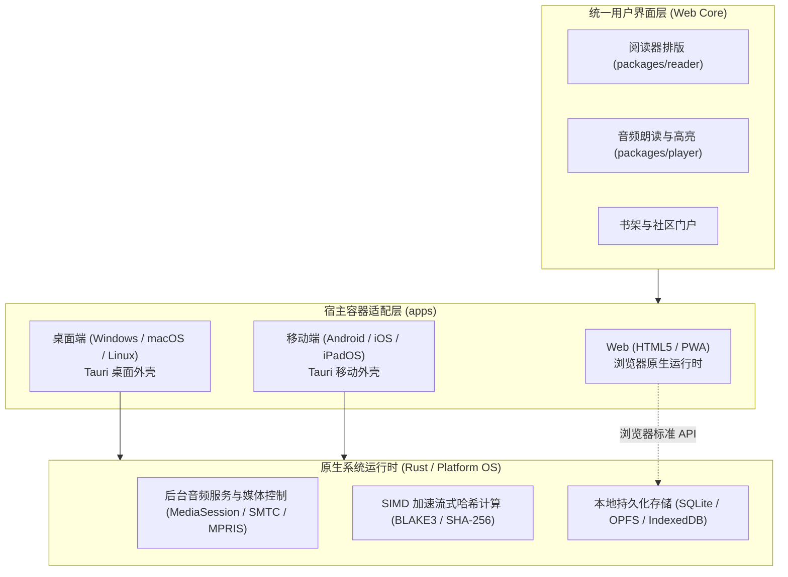

[English](architecture.md) | [简体中文](architecture_CN.md)

# 架构

当前实现为 Windows TXT 阅读器原型。目标平台及服务在下文单独说明。

## 当前组件

    apps/windows/
      src/                  Vue 视图、会话书架状态、段落映射
      native/src/           Tauri 命令、导入、路径、SQLite、核验决策
      tests/                使用模拟宿主边界的真实处理函数/模块测试
    packages/reader/        TXT 解码、标题选择、结构校验
    protocol/               Rust 契约、BLAKE3 标识、TypeScript 绑定
    server/gateway/         健康检查和 ping 端点
    tools/                  本地检查与执行回执

原生宿主依赖 reader、protocol；reader 依赖 protocol。前端使用生成的绑定及 Tauri IPC，不直接访问 SQLite。网关依赖 protocol，尚未实现账号、认证、CAS 或同步。

Vue 视图负责交互和生命周期。书架状态库负责会话选择，在原生操作成功后发布持久化变更。text 模块统一提供段落/句子映射。阻塞工作线程执行原生导入及数据库操作，界面分别观察进度和完成状态。

## 阅读界面与视觉标识

阅读工具栏包含三个图标按钮：返回书架、切换章节目录、打开阅读设置。设置以 2 px 为步长调整当前会话字号，范围为 16–32 px。外部指针操作或 Escape 关闭浮层；Escape 将焦点移回触发按钮。目录和 PageUp/PageDown 仍可切换章节。

阅读底栏、全局迷你条及书架伴读操作，要求当前书籍已加载非空音频 Blob，且 MIME 类型为音频。文件名或扩展名不代表存在音频。无音频时，Space 保持正常滚动；移除音频时停止演示定时器。该检查不校验编解码器可解码性或时间轴对齐。

当前 TXT 导入不提供音频。.saga 解析器和真实播放尚未实现。[READ-01](evidence/2026-10-20-reader/result.json)记录当前控件行为与资源检查，不代表支持 .saga。

侧边栏将图标与 Saga 字标整体居中，折叠时图标单独居中。Windows 任务栏/标题栏使用可执行文件中的 ICO 资源。Tauri 配置列出资产，构建脚本跟踪 ICO 变更。

apps/windows/native/icons/source.png 是 PNG/ICO/ICNS 及浏览器资产的共享母版。母版紧贴可见圆角底板裁切，外部像素透明，不增加留白。侧边栏按该轮廓绘制支持 Alpha 通道的投影。导出规范化处理清除了 ICO 四个顶角像素的残余不透明度。ICON-03 记录边距、角点 Alpha 及可执行文件图像帧比对结果。

## 数据流与限制

1. 原生选择框返回 TXT 路径。导入读取字节、计算 BLAKE3 标识、解码文本并选定章节边界。
2. SQLite 存储书籍元数据、有序章节索引与分块偏移量，以及已保留的核验指纹。所有章节正文与 Deflate 压缩分块（严格限制在 256 KB 以内）直接打包封装为单文件 `.saga` 归档容器并保存在 `books/<book-id>.saga` 下，磁盘上不创建任何书籍子目录。重导入在一个原子事务中替换元数据与 `.saga` 归档文件；核验保存同时提交章节及决策。
3. 书架先加载摘要，选择书籍后再加载章节。重复请求共享进行中的加载。通过书籍对象标识，防止延迟响应覆盖重导入结果或使已删除书籍重新出现。
4. 缺少持久化分句时，阅读器按需分句。浏览器预览将完整 TXT 作为单个临时章节保存在内存中，不经过原生解析。

调试数据位于编译时检出目录的 data/ 下。打包构建使用操作系统的应用本地数据目录。布局为 `storage/saga.db` 和单归档包 `books/<book-id>.saga`。移动检出目录后须重建调试程序；已有程序保留编译时的源码位置。

SQLite 与 `.saga` 归档文件统一协同管理。导入/删除事务确保元数据与归档的一致性，断电持久性尚未完成合格性认定。[维护文档](maintenance_CN.md)说明故障保证及仅本地保存的证据引用。本次整理未移动或重新解析现有开发数据。

TTS、真实音频播放、EPUB 导入、时间轴对齐、同步、完整 CAS、其他平台及发布打包仍列于[任务台账](tasks_CN.md)。

## .saga 资产包规范

规范的 `.saga` 容器是一个标准化、确定性的 ZIP 归档（RFC 1951），作为不可变且自包含的数字出版物运行。它将内容组织为五个正交的架构支柱：

```text
my_novel.saga (标准确定性 ZIP 容器)
├── mimetype          # 身份层：未压缩 (STORE) 格式签名
├── manifest.bin      # 调度层：二进制元数据 + 章节目录 TOC + 音频路由
├── texts/            # 内容层：严格 <= 256 KB 的多章 Deflate 正文切片
│   ├── 0.chunk
│   └── ...
├── timeline.bin      # 时序层：懒加载的句子毫秒级对齐跨度
├── audio/            # 音频层：未压缩 (STORE) 的 AAC/Opus 音频轨
└── cover.jpg         # 媒体层：独立的封面图像，用于书架水合
```

### 1. 架构支柱与加载生命周期

| 支柱 | 文件路径 | 压缩方式 | 生命周期与性能契约 |
| :--- | :--- | :--- | :--- |
| **身份** | `mimetype` | STORE (0%) | 位于字节偏移 30 处的固定 24 字节（`application/x-saga-book`）。外部文件管理器无需解包即可嗅探。Saga 阅读器运行时启动时忽略它（零 I/O）。 |
| **调度** | `manifest.bin` | STORE (0%) | 20–30 KB 定长二进制 TOC 与 UTF-8 字符串池。打开书籍时严格加载一次（1 次 I/O）。提供即时元数据、目录树、切片路由以及章节音频可用性。 |
| **内容** | `texts/*.chunk` | DEFLATE | 严格限制在 256 KB 以内的多章正文块。按需加载：打开书籍仅解压当前阅读的分块（1 次 I/O）。段落由 `\n\n` 自然界定；语句在内存中按需确定性切分（零索引膨胀）。 |
| **时序** | `timeline.bin` | DEFLATE | 句子级毫秒对齐跨度。纯文本阅读期间绝不读取。仅在有声伴读处于活动状态时按章节懒加载（每章约 300 字节）。 |
| **音频** | `audio/*.m4a` | STORE (0%) | 连续的物理音频流字节。操作系统硬件解码器（MediaEngine、AVPlayer）通过文件描述符偏移直接流式播放，无需中间解压。 |
| **媒体** | `cover.jpg` | STORE / 原始 | 独立的封面图片。书架视图独立读取，无需解析章节索引；在正文阅读期间忽略。 |

### 2. 二进制清单布局 (`manifest.bin`)

`manifest.bin` 取代了原本用于出版物存储的数据库章节表。它使用算术级 $O(1)$ 可寻址项表：

1. **头部 Header (64 字节)**:
   - `magic`: 4 字节 (`SGMF`)。
   - `version`: `u16` 格式修订版本。
   - `flags`: `u16` 出版物功能标志。
   - `sections_count`: `u32` 结构化章节总数。
   - `chunks_count`: `u32` `texts/` 下正文切片文件总数。
   - `total_chars`: `u32` 全书总字数。
   - `title_ptr`: `[offset: u32, len: u16]` 指向字符串池中的书名。
   - `author_ptr`: `[offset: u32, len: u16]` 指向字符串池中的作者名。
   - `desc_ptr`: `[offset: u32, len: u16]` 指向字符串池中的简介。
   - `toc_offset`: `u64` 定长 TOC 数组起始字节偏移。
   - `string_pool_offset`: `u64` UTF-8 文本属性起始字节偏移。
   - `reserved`: 20 字节保留用于未来模式扩展。
2. **章节目录项 TOC Entries (每章 32 字节，严格 8 字节对齐)**:
   - `chunk_index`: `u16` 引用 `texts/{chunk_index}.chunk`。
   - `flags`: `u16` 标志位（bit 0 表示伴读音频可用性）。
   - `chunk_offset`: `u32` 解压后切片内的未压缩字节起始位置。
   - `byte_length`: `u32` 未压缩章节文本字节长度。
   - `char_count`: `u32` 章节字符数（用于进度计算）。
   - `volume_id`: `u16` 卷序号。
   - `title_offset`: `u32` 标题在字符串池中的相对偏移量。
   - `title_length`: `u16` 标题 UTF-8 字节长度。
   - `audio_duration_ms`: `u32` 章节音频总毫秒时长。
   - `timeline_offset`: `u32` 该章句子跨度在 `timeline.bin` 中的字节偏移量。
3. **字符串池 String Pool**:
   - 连续紧密排列的 UTF-8 字节序列，保存书名、作者、简介及章节标题。

### 3. 出版物资产与用户状态分离

- **出版物资产 (`.saga`)**：不可变、内容寻址（BLAKE3）且抗崩溃。可跨设备零副作用安全共享。
- **用户状态 (`saga.db`)**：本地客户端 SQLite 数据库，保存可变用户数据：
  - 阅读进度锚点：`{ chapter_index: u32, paragraph_index: u16, sentence_index: u16, char_offset: u16, scroll_ratio: f16 }`（仅 12 字节）。
  - 用户高亮划线、书签、批注笔记与本地书架元数据。

## 目标设计 —— 未作为完整系统实现

以下设计仍为预期的演进方向。规划中的目录名称描述未来职责，并非创建空壳组件的理由。性能指标均为该评估中的设计目标或历史假设，并非当前实际测量值。

### 1. 软件定位与设计原则

- **软件定义**：统一的全平台数字图书阅读与有声沉浸听书套件。
- **目标平台（7 大目标）**：Android、iOS、iPadOS、macOS、Windows、Linux 以及 HTML（标准 Web / PWA）。
- **本地优先（Local-First）**：书架、缓存书籍文件及音频章节在离线状态下完全可用；连网时自动静默进行增量同步。
- **伴读同步（Read-Along）**：解析后的文本片段与生成的音频流之间具备句子级时间戳对齐，支持朗读时正文实时高亮并平滑自动滚动。
- **内容寻址存储（CAS）**：书籍与音频物理资产通过加密内容哈希寻址与去重，支持全网秒传与多用户零拷贝用户间共享。

---

### 2. 仓库与模块目录结构

依据 [docs/coding_CN.md](coding_CN.md) 的基线规则（单完整词命名、利用上级作用域消除冗余前后缀、清晰职责所有权）：

```text
saga/
├── apps/                        # 交付宿主 (按平台/分发独立维护)
│   ├── web/                     # 统一 HTML5 前端应用 (Web SPA / PWA)
│   ├── desktop/                 # 桌面端宿主壳 (Tauri: Windows / macOS / Linux)
│   └── mobile/                  # 移动端宿主壳 (Tauri Mobile: Android / iOS / iPadOS)
│
├── packages/                    # 客户端领域模块 (供 apps 组装)
│   ├── reader/                  # 书籍解析、流式排版与渲染 (EPUB / TXT)
│   ├── player/                  # 音频播放控制、后台保活与高亮时间轴驱动
│   ├── speech/                  # 文本切句分词与 TTS 合成调用抽象
│   ├── storage/                 # 本地离线持久化 (IndexedDB / SQLite 统一适配)
│   └── sync/                    # 客户端增量同步状态机与离线变更队列
│
├── server/                      # 服务端组件 (以单完整词表达职责)
│   ├── gateway/                 # API 网关、用户认证 (JWT/Passkey) 与限流
│   ├── cas/                     # 内容寻址存储、哈希去重索引与底层物理对象管理
│   ├── sync/                    # 账号元数据、阅读进度与书签的增量合并服务
│   └── share/                   # 资源分享口令与社区广场聚合
│
├── protocol/                    # 跨端公共协议与 Schema 唯一源 (RPC / JSON Schema / 错误码)
├── tools/                       # 构建、代码生成、开发与维护工具
├── tests/                       # 跨组件端到端集成测试与协议验证
└── docs/                        # 通用工程规范与技术架构文档
```

---

### 3. 全平台客户端架构



- **统一 Web 核心**：采用现代 Web 标准构建（TypeScript + 响应式组件框架 + Tailwind CSS）。全部阅读排版、分页布局、虚拟滚动及伴读高亮逻辑在 7 大平台间 100% 共享。
- **iPadOS 深度适配**：响应式双页并排、分屏浏览（Split View）、侧拉浮窗（Slide Over）以及 Apple Pencil/触控手势支持。
- **原生宿主底座**：桌面端与移动端运行于 Tauri 2.0 外壳内部，将后台音频保活、锁屏控制器及重度哈希计算委托给原生 Rust 执行。

---

### 4. 内容寻址存储（CAS）与哈希去重

#### 4.1 哈希算法与对象寻址
- 物理资产（原始书籍文件与音频切片流）通过加密内容哈希（**BLAKE3** 或 **SHA-256**）唯一标识。
- 物理存储采用标准两级前缀分片：
  `/cas/{hash[0:2]}/{hash[2:4]}/{hash}`

#### 4.2 音频合成幂等性指纹
为避免不同用户在以相同语音设置收听相同文本内容时发生重复 TTS 合成：
$$\text{AudioGenHash} = \text{Hash}(\text{CleanedText} + \text{Model} + \text{Voice} + \text{Speed} + \text{Pitch})$$
当合成请求与书目中的现有指纹匹配时，服务端直接返回已有的音频 Blob 引用，无需再次调用 TTS 合成管线。

#### 4.3 秒传预检与引用计数
1. **预检（Pre-flight Check）**：客户端在本地计算目标文件的内容哈希，发起 `POST /api/cas/check` 请求携带 `{ hash, size, mime_type }`。
2. **命中缓存**：若物理 Blob 已存在于 CAS 资源池中，服务端创建一条关联至用户个人书架的逻辑引用，递增该 Blob 的引用计数，并立即返回成功（低于一秒）。
3. **未命中缓存**：客户端通过分块流式上传文件。服务端在入库 CAS 资源池前对照预期哈希校验文件完整性。
4. **垃圾回收（GC）**：当用户删除引用时，引用计数递减。当计数归零后，对象进入宽限期（例如 30 天）以供自动回收。

---

### 5. 账号数据与本地优先增量同步

- **同步状态范围**：阅读进度（章节、字符偏移、滚动百分比）、音频进度（已播放秒数）、书签、划线高亮、批注笔记与用户偏好。
- **变更日志协议**：离线状态下的变更缓冲在本地仅追加写入的 `mutation_log` 中，并附加混合逻辑时钟（HLC）时间戳。连网后客户端提交增量变更，网络载荷极其轻量（通常小于 10 KB）。
- **冲突解决**：采用基于单调逻辑时间戳的最后写入者获胜（LWW）策略，自动裁决多设备间的并发阅读进度分歧。

---

### 6. 社区扩展与资源分享

- **零拷贝资源转存**：
  - 用户可为书籍、有声书包（书籍 + 时间轴清单 + 音频 Blobs）或精选书单生成加密分享口令（`Share Tokens`）。
  - 接收方兑换口令时，直接在个人书库中生成指向既有 CAS 物理对象的元数据指针，在服务端不产生任何额外物理存储开销。
- **扩展插件沙箱**：
  - 为第三方书源刮削器与目录元数据抓取器提供沙箱化执行接口。
  - 抽象可插拔的 `TTSProvider` 规范，支持云端提供商（Edge-TTS、OpenAI、Azure）与本地推理引擎（Piper、Sherpa-ONNX、CosyVoice）。
