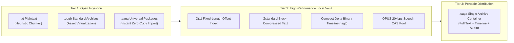

[English](proposals.md) | [简体中文](proposals_CN.md)

# Technical Proposals

Both proposals are PENDING REVIEW. Mechanisms, examples, performance figures, and API shapes below describe proposed designs, not delivered behavior or measurements. Review precedes incorporation into [architecture.md](architecture.md). Current implementation and generation paths are defined there and in [maintenance.md](maintenance.md).

## Proposal 1: Reader, speech, storage, and CAS mechanisms

Status: PENDING REVIEW. Registered: 2026-10-18. Scope: packages/reader, packages/player, packages/speech, packages/storage, server/cas, protocol/.

### 1. Reader parsing and pagination

EPUB ingestion would stream ZIP contents, resolve META-INF/container.xml and content.opf, and read manifest assets and spine order. ResourceRegistry: Map<normalized_path, Blob> would map local assets to URL.createObjectURL(blob) during XHTML conversion. A current ±1 chapter window would revoke object URLs through cleanupChapter(chapterId) when unmounted.

TXT detection would inspect the first 8 KB, detect UTF-8/UTF-16 LE/BE BOMs, validate UTF-8, and fall back to TextDecoder('gb18030') for invalid sequences. The proposed heading pattern is:

```regex
  /(?:^|\n)\s*(第[0-9一二三四五六七八九十百千万]+[章回节卷集部篇幕话]|Chapter\s+\d+|[0-9]+\s+[^\n]{1,30})\s*([^\n]{0,30})/g
  ```

Sentence splitting would keep terminal punctuation and trailing closing marks together, including quoted dialogue. The recorded terminal set is 。！？；… and newline; closing marks include ”, ", ）, and ]. The proposed DOM shape is:

```html
  <p class="saga-p" data-p-id="p12">
    <span class="saga-chunk" data-chunk-id="c1-p12-s1">话说天下大势，分久必合，合久必分。</span>
    <span class="saga-chunk" data-chunk-id="c1-p12-s2">周末七国分争，并入于秦。</span>
  </p>
  ```

Pagination would use native CSS columns:

```css
  .saga-viewport { width: 100vw; height: 100vh; overflow: hidden; }
  .saga-columns {
    column-width: 100vw; column-gap: 40px; column-fill: auto; height: 100%;
    transform: translateX(calc(-1 * var(--current-page) * (100vw + 40px)));
    transition: transform 0.25s cubic-bezier(0.2, 0, 0, 1);
  }
  ```

On resize, rotation, or typography changes, preserve currentChunkId and recompute:

    newPage = floor(targetElement.offsetLeft / (clientWidth + columnGap))

Set --current-page to newPage to keep that sentence visible.

### 2. Audio alignment and follow behavior

The proposed manifest is:

```json
{
  "version": "1.0",
  "audio_hash": "b3_0123456789abcdef...",
  "chapter_id": "c1",
  "format": "opus",
  "duration_ms": 325400,
  "spans": [
    { "id": "c1-p1-s1", "start_ms": 0, "end_ms": 2840, "text": "第一回 宴桃园豪杰三结义" },
    { "id": "c1-p2-s1", "start_ms": 2900, "end_ms": 6120, "text": "话说天下大势，分久必合，合久必分。" }
  ]
}
```

Sample current_ms at 30–60 Hz. Search ordered spans in O(log N) for start_ms <= current_ms < end_ms; the recorded lookup target is below 0.01 ms. If hit_id equals activeChunkId, leave the DOM unchanged. Otherwise transfer .active-sentence to the new element and update activeChunkId.

Use LOCKED_FOLLOW and USER_BROWSING states. touchstart, wheel, or pointerdown enters USER_BROWSING, suspends following, and resets a five-second inactivity timer. Expiry returns to LOCKED_FOLLOW and calls scrollIntoView({ behavior: 'smooth', block: 'center' }).

### 3. Speech requests

Split long chapters, including the recorded 8,000-word case, at paragraph boundaries into 800–1500-word BatchTrack units. The first-batch synthesis target is 1–2 seconds; later batches synthesize while playback proceeds.

The proposed local-model endpoint is POST {local_endpoint}/v1/audio/speech for services such as CosyVoice/GPT-SoVITS:

```json
    {
      "model": "cosyvoice-v2",
      "input": "...",
      "voice": "custom_01",
      "response_format": "opus",
      "with_timestamps": true
    }
    ```

Return Opus audio and alignment timestamps through SSE or header manifests. Endpoint compatibility and timing remain to be verified.

### 4. Protocol generation and local storage

Rust is the protocol source, with ts-rs producing TypeScript bindings. This original example is illustrative; its export path and .d.ts wording are not the current generation contract:

```rust
  #[derive(Serialize, Deserialize, TS)]
  #[ts(export, export_to = "../packages/protocol/src/bindings/")]
  pub struct SentenceChunk {
      pub id: String,
      pub chapter_id: String,
      pub text: String,
  }
  ```

Current types and generated files are under protocol/src/lib.rs and protocol/bindings/. Generation does not by itself prove semantic compatibility.

| Data | Web/PWA proposal | Tauri desktop/mobile proposal |
| --- | --- | --- |
| Shelf, progress, bookmarks | IndexedDB through idb | SQLite |
| EPUB and audio assets | OPFS | Application data under {app_data}/cas/ |

The OPFS proposal uses filesystem streaming for large assets rather than storing them as IndexedDB Blobs.

### 5. CAS transfer

BLAKE3 is the proposed default, with /cas/{hash[0:2]}/{hash[2:4]}/{hash} sharding. The recorded, unmeasured assumption is a 100 MB audio hash below 30 ms, 4–10 times faster than SHA-256.

1. POST /api/cas/check sends { hash, size, mime }; a hit adds a reference.
2. A miss above 20 MB obtains S3 presigned PUT URLs for 5 MB parts, uploaded directly to R2.
3. POST /api/cas/commit verifies checksums and finalizes registration.

## Proposal 2: Storage engine, .sgtl timeline, and .saga container

Status: PENDING REVIEW. Registered: 2026-10-19. Scope: packages/storage, packages/reader, packages/player, protocol/, server/cas.

### 1. Lifecycle

The proposal combines text, hierarchical book metadata, and sentence timing. It was motivated by the different scopes of EPUB/SMIL overlays, M4B/AAC chapter cues, and LRC/WebVTT/SRT subtitles.



### 2. Chapter index

Compile TXT/EPUB into a fixed-length index and Zstandard chapter blocks. The proposed 64-byte record is:

```rust
#[repr(C, packed)]
pub struct ChapterRecord {
    pub chapter_id: u32,
    pub title_offset: u32,
    pub title_len: u16,
    pub flags: u16,
    pub body_offset: u64,
    pub body_compressed_len: u32,
    pub body_uncompressed_len: u32,
    pub sentence_count: u32,
    pub audio_hash: [u8; 32], // BLAKE3 CAS fingerprint
}
```

Chapter N would seek to N × 64 in O(1). Recorded targets are seek below 0.05 ms, Zstandard level 3, a 15 KB block decompressed below 0.01 ms at over 3 GB/s, and text storage reduced by more than 60%. These are not benchmark results.

### 3. Binary timeline

| Field | Proposed encoding |
| --- | --- |
| Magic | Four bytes: SGTL |
| Version | u8, initially 1 |
| Flags | u8; bit 0 delta encoding, bit 1 microsecond precision |
| Span count | u32 |
| Span duration | duration_ms: u16; up to 65,535 ms, approximately 65.5 s; overflow escapes to u32 |
| Text length | char_len: u16, Unicode codepoints |

The delta proposal assumes start[i] = end[i-1]. Units, flags, and overflow details remain subject to review. The recorded estimate for 10,000 sentences is 2.5 MB JSON versus 40 KB binary, a 98.4% reduction, with mmap access.

### 4. Audio encoding

The proposed format is Opus, SILK speech mode, VBR mono, 16–24 kbps, at 24 kHz/48 kHz. Historical assumptions compare 20 kbps Opus with 64 kbps MP3, estimate 65–75% less storage/transfer, and reduce a 100-hour title from about 4 GB to below 900 MB. Quality and size require measurement.

### 5. Portable container

The proposed .saga file uses standard ZIP:

```text
novel.saga (Standard Zip Container)
├── manifest.json       <-- Metadata, BLAKE3 checksums, chapter tree (protocol::Manifest)
├── index.bin           <-- Compiled O(1) chapter offset table
├── text/
│   ├── ch0001.zst      <-- Zstd compressed text stream
│   └── ch0002.zst
├── timeline/
│   ├── ch0001.sgtl     <-- Compact binary alignment timeline
│   └── ch0002.sgtl
└── audio/
    ├── ch0001.opus     <-- Standard OPUS speech audio stream
    └── ch0002.opus
```

Standard ZIP tools would extract Opus and compressed text payloads. Import would verify BLAKE3 identities and place existing chunks in CAS without retranscription or resynthesis. The manifest layout is a draft; it is not the current protocol::Manifest schema.

### 6. Proposed optimizations

- **Page alignment:** Store precompressed Zstd/Opus entries with ZIP method 0 at 4096-byte boundaries. memmap2 would map the archive to avoid full extraction.
- **Word timing:** Keep sentence anchors (duration_ms: u16, char_len: u16) and optionally add intra-sentence delta_ms: u8 increments. Targets are below 20 additional bytes per sentence, below 200 KB for a whole-book word timeline, and over 95% reduction versus JSON.
- **Gapless playback:** At 90% of chapter N, predecode the first three seconds of N+1. Sample-level crossfades would address the recorded 10–50 ms gap/pop concern.
- **Semantic anchors:** Compute AnchorHash = BLAKE3(Normalize(Sentence))[0..4], a truncated 32-bit hash, and address progress by (chapter_id, AnchorHash). Resilience to typo edits, normalization, collisions, and reflow remains an intended property requiring review, not a proven invariant.


