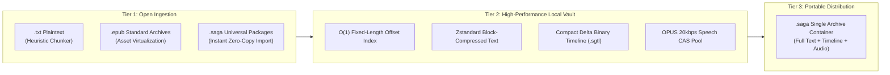

[English](proposals.md) | [简体中文](proposals_CN.md)

# 技术提案

两项提案均为 PENDING REVIEW。下述机制、示例、性能指标和 API 结构属于设计提议，不代表已交付行为或实测结果。审核通过后方可纳入[架构文档](architecture_CN.md)。当前实现及生成路径由架构文档和[维护文档](maintenance_CN.md)规定。

## 提案 1：阅读、语音、存储与 CAS 机制

状态：PENDING REVIEW。登记日期：2026-10-18。范围：packages/reader、packages/player、packages/speech、packages/storage、server/cas、protocol/。

### 1. 阅读解析与分页

EPUB 导入计划流式读取 ZIP，解析 META-INF/container.xml 和 content.opf，读取 manifest 资产及 spine 顺序。ResourceRegistry: Map<normalized_path, Blob> 在 XHTML 转换期间，通过 URL.createObjectURL(blob) 映射本地资产。当前章节及前后各一章（±1）的窗口卸载时，通过 cleanupChapter(chapterId) 撤销对象 URL。

TXT 检测计划检查前 8 KB，识别 UTF-8/UTF-16 LE/BE BOM，校验 UTF-8，发现非法序列时回退至 TextDecoder('gb18030')。提议的标题规则为：

```regex
  /(?:^|\n)\s*(第[0-9一二三四五六七八九十百千万]+[章回节卷集部篇幕话]|Chapter\s+\d+|[0-9]+\s+[^\n]{1,30})\s*([^\n]{0,30})/g
  ```

分句时保留句末标点及其后的闭合符号，包括引号内对话。已记录的句末符号为 。！？；… 及换行；闭合符号包括 ”、"、）和 ]。提议的 DOM 结构为：

```html
  <p class="saga-p" data-p-id="p12">
    <span class="saga-chunk" data-chunk-id="c1-p12-s1">话说天下大势，分久必合，合久必分。</span>
    <span class="saga-chunk" data-chunk-id="c1-p12-s2">周末七国分争，并入于秦。</span>
  </p>
  ```

分页计划使用原生 CSS 多列：

```css
  .saga-viewport { width: 100vw; height: 100vh; overflow: hidden; }
  .saga-columns {
    column-width: 100vw; column-gap: 40px; column-fill: auto; height: 100%;
    transform: translateX(calc(-1 * var(--current-page) * (100vw + 40px)));
    transition: transform 0.25s cubic-bezier(0.2, 0, 0, 1);
  }
  ```

窗口缩放、旋转或排版设置变化时，保留 currentChunkId 并重新计算：

    newPage = floor(targetElement.offsetLeft / (clientWidth + columnGap))

将 --current-page 设为 newPage，使该句保持可见。

### 2. 音频对齐与跟随行为

提议的清单为：

```json
{
  "version": "1.0",
  "audio_hash": "b3_0123456789abcdef...",
  "chapter_id": "c1",
  "format": "opus",
  "duration_ms": 325400,
  "spans": [
    { "id": "c1-p1-s1", "start_ms": 0, "end_ms": 2840, "text": "第一回 宴桃园豪杰三结义" },
    { "id": "c1-p2-s1", "start_ms": 2900, "end_ms": 6120, "text": "话说天下大势，分久必合，合久必分。" }
  ]
}
```

以 30–60 Hz 采样 current_ms。在有序 spans 中以 O(log N) 查找满足 start_ms <= current_ms < end_ms 的片段；已记录的查找目标为低于 0.01 ms。hit_id 等于 activeChunkId 时不改动 DOM；否则将 .active-sentence 移至新元素，并更新 activeChunkId。

采用 LOCKED_FOLLOW、USER_BROWSING 两个状态。touchstart、wheel 或 pointerdown 进入 USER_BROWSING，暂停跟随并重置五秒无操作计时器。到期后返回 LOCKED_FOLLOW，调用 scrollIntoView({ behavior: 'smooth', block: 'center' })。

### 3. 语音请求

对长章节（包括已记录的 8,000 词场景）按段落边界切分为 800–1500 词的 BatchTrack 单元。首批合成目标为 1–2 秒；播放期间并行合成后续批次。

面向 CosyVoice/GPT-SoVITS 等服务，提议的本地模型端点为 POST {local_endpoint}/v1/audio/speech：

```json
    {
      "model": "cosyvoice-v2",
      "input": "...",
      "voice": "custom_01",
      "response_format": "opus",
      "with_timestamps": true
    }
    ```

通过 SSE 或响应头清单返回 Opus 音频及对齐时间戳。端点兼容性和耗时仍待验证。

### 4. 协议生成与本地存储

Rust 作为协议源，由 ts-rs 生成 TypeScript 绑定。下列原示例仅作说明；其中的导出路径及 .d.ts 表述不属于当前生成契约：

```rust
  #[derive(Serialize, Deserialize, TS)]
  #[ts(export, export_to = "../packages/protocol/src/bindings/")]
  pub struct SentenceChunk {
      pub id: String,
      pub chapter_id: String,
      pub text: String,
  }
  ```

当前类型和生成文件位于 protocol/src/lib.rs、protocol/bindings/。完成生成本身不能证明语义兼容。

| 数据 | Web/PWA 提议 | Tauri 桌面/移动端提议 |
| --- | --- | --- |
| 书架、进度、书签 | 通过 idb 使用 IndexedDB | SQLite |
| EPUB 与音频资产 | OPFS | 应用数据目录下的 {app_data}/cas/ |

OPFS 方案对大型资产使用文件系统流式读取，而非将其作为 Blob 存入 IndexedDB。

### 5. CAS 传输

提议默认使用 BLAKE3，并采用 /cas/{hash[0:2]}/{hash[2:4]}/{hash} 分片。已记录但未经测量的假设为：100 MB 音频哈希低于 30 ms，比 SHA-256 快 4–10 倍。

1. POST /api/cas/check 发送 { hash, size, mime }；命中时增加引用。
2. 超过 20 MB 的未命中文件获取每片 5 MB 的 S3 预签名 PUT URL，直接上传至 R2。
3. POST /api/cas/commit 核对校验和并完成登记。

## 提案 2：存储引擎、.sgtl 时间轴与 .saga 容器

状态：PENDING REVIEW。登记日期：2026-10-19。范围：packages/storage、packages/reader、packages/player、protocol/、server/cas。

### 1. 生命周期

提案将文本、分层书籍元数据和句子时间信息组合保存。其动因是 EPUB/SMIL 叠加媒体、M4B/AAC 章节标记及 LRC/WebVTT/SRT 字幕的职责范围不同。



### 2. 章节索引

计划将 TXT/EPUB 编译为定长索引及 Zstandard 章节块。提议的 64 字节记录为：

```rust
#[repr(C, packed)]
pub struct ChapterRecord {
    pub chapter_id: u32,
    pub title_offset: u32,
    pub title_len: u16,
    pub flags: u16,
    pub body_offset: u64,
    pub body_compressed_len: u32,
    pub body_uncompressed_len: u32,
    pub sentence_count: u32,
    pub audio_hash: [u8; 32], // BLAKE3 CAS fingerprint
}
```

第 N 章通过 N × 64 偏移量以 O(1) 定位。已记录目标为：定位低于 0.05 ms，使用 Zstandard 级别 3，以超过 3 GB/s 的吞吐在低于 0.01 ms 的时间内解压 15 KB 块，文本存储减少超过 60%。这些不是基准测试结果。

### 3. 二进制时间轴

| 字段 | 提议编码 |
| --- | --- |
| 魔数 | 四字节：SGTL |
| 版本 | u8，初始为 1 |
| 标志 | u8；位 0 为增量编码，位 1 为微秒精度 |
| 片段数量 | u32 |
| 片段时长 | duration_ms: u16；最大 65,535 ms，约 65.5 s；溢出时转义为 u32 |
| 文本长度 | char_len: u16，单位为 Unicode 码点 |

增量方案假设 start[i] = end[i-1]。单位、标志和溢出细节仍须审核。对 10,000 个句子的已记录估计为：JSON 2.5 MB、二进制 40 KB，减少 98.4%，并支持 mmap 访问。

### 4. 音频编码

提议格式为 Opus，采用 SILK 语音模式、VBR 单声道、16–24 kbps、24 kHz/48 kHz。历史假设将 20 kbps Opus 与 64 kbps MP3 对比，估计存储/传输减少 65–75%，并将 100 小时书籍由约 4 GB 减至低于 900 MB。质量和体积需要测量。

### 5. 便携容器

提议的 .saga 文件使用标准 ZIP：

```text
novel.saga (Standard Zip Container)
├── manifest.json       <-- Metadata, BLAKE3 checksums, chapter tree (protocol::Manifest)
├── index.bin           <-- Compiled O(1) chapter offset table
├── text/
│   ├── ch0001.zst      <-- Zstd compressed text stream
│   └── ch0002.zst
├── timeline/
│   ├── ch0001.sgtl     <-- Compact binary alignment timeline
│   └── ch0002.sgtl
└── audio/
    ├── ch0001.opus     <-- Standard OPUS speech audio stream
    └── ch0002.opus
```

标准 ZIP 工具可提取 Opus 和压缩文本载荷。导入计划校验 BLAKE3 标识后，将已有块放入 CAS，无需重新转写或合成。清单结构仍为草案，不是当前 protocol::Manifest 模式。

### 6. 提议的优化

- **页对齐：** 采用 ZIP 方法 0，将已压缩的 Zstd/Opus 条目对齐至 4096 字节边界。memmap2 映射归档，避免完整解包。
- **字词时间信息：** 保留句子锚点（duration_ms: u16、char_len: u16），按需追加句内 delta_ms: u8 增量。目标为每句额外低于 20 字节、全书字词时间轴低于 200 KB、相对 JSON 减少超过 95%。
- **无间隙播放：** 第 N 章播放至 90% 时，预解码 N+1 章的前三秒。通过采样级交叉淡入淡出，处理已记录的 10–50 ms 间隙/爆音问题。
- **语义锚点：** 计算截断为 32 位的 AnchorHash = BLAKE3(Normalize(Sentence))[0..4]，通过 (chapter_id, AnchorHash) 定位进度。对错字修改、归一化、哈希碰撞及重排的适应性仍是待审核目标，不是已证明的不变量。


